# QQBot Bridge

把手机 QQ 变成本机 agent 的遥控器（默认 CodeBuddy，也可以换成 Cursor）：扫码绑定一个 QQ 机器人，
然后在 QQ 里发指令，桥接服务在你指定的项目目录里跑 agent，过程、结果、截图自动发回手机。

<p align="center">
  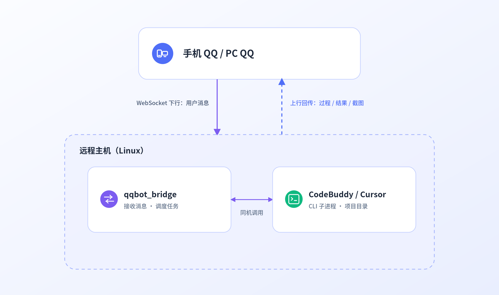
</p>

斜杠指令（`/list` `/switch` `/status` …）由 `qqbot_bridge` 直接处理；普通消息交给 `codebuddy` / `cursor-agent` 在会话目录里执行。

## 效果预览

手机上只有 QQ 也没关系：发一句指令，过程、结果和截图自动回到聊天窗口；回到电脑再用 Web 管理端看全部细节。

<p align="center">
  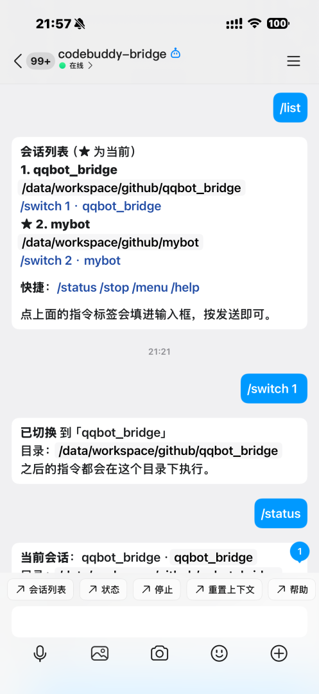
  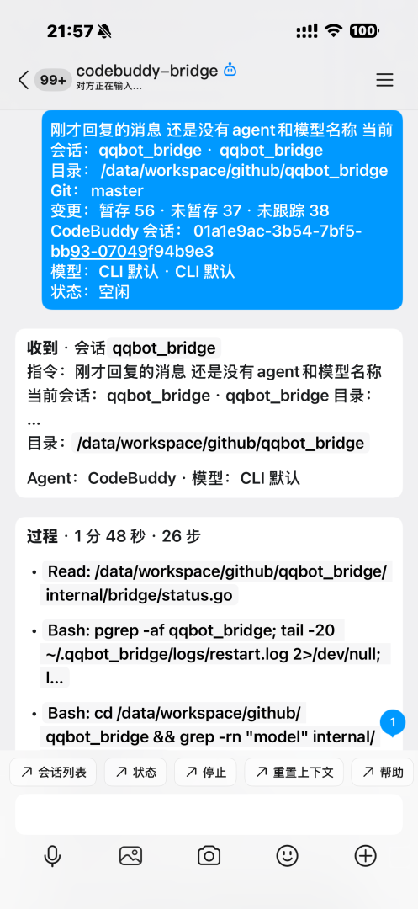
  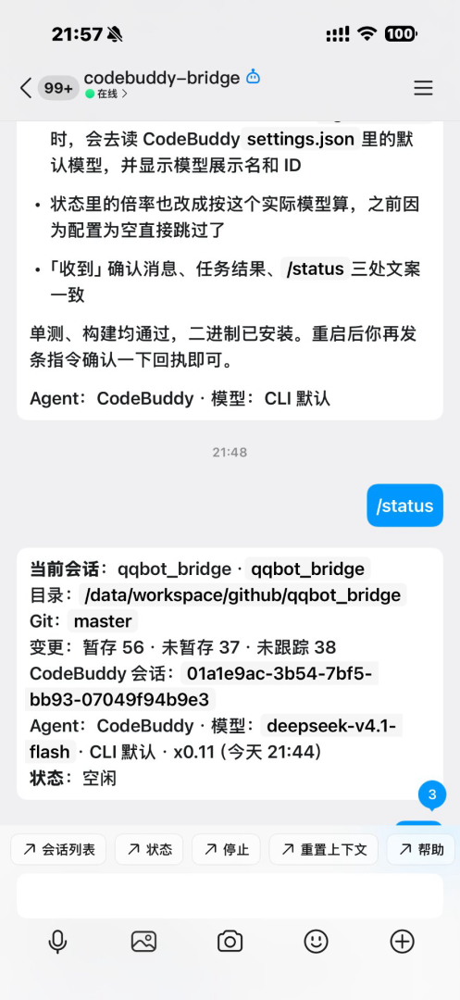
  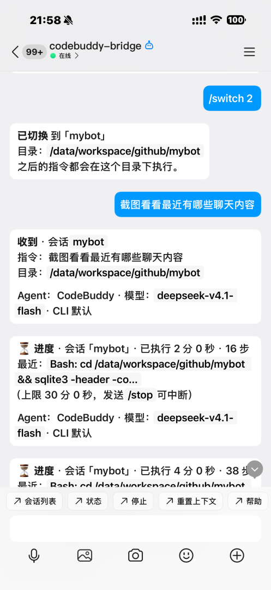
  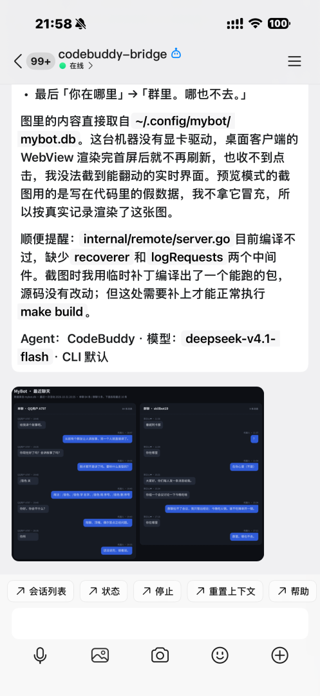
</p>

<p align="center"><sub>从左到右：<code>/list</code> 会话列表 · 执行过程 · <code>/status</code> · <code>/switch</code> 与长任务进度 · 结果回传</sub></p>

## 前置条件

- Linux 或 macOS（Windows 只能 `-f` 前台运行）
- Go 1.26+（只用来编译，装好后不需要；以 `go.mod` 里的 `go` 指令为准，`install.sh` 会检查）
- 已安装并登录 CodeBuddy CLI：`codebuddy --version` 能跑通（想改用 Cursor 的话装 `cursor-agent` 即可，见「使用 Cursor」）
- 可选：Node.js，仅用于跑前端 Markdown 渲染器的单测，没有也不影响使用和 `go test`
- 一个能扫码的 QQ 号（用来绑定机器人）

## 安装

```bash
git clone <本仓库> qqbot_bridge && cd qqbot_bridge
./scripts/install.sh            # 编译并安装到 ~/.local/bin
./scripts/install.sh --service  # 顺便装成 systemd 用户服务
```

脚本做三件事：检查 Go 和 codebuddy、编译 `qqbot_bridge`（把 git 版本和构建时间编进去，
`qqbot_bridge -v` 可查）、装进 `~/.local/bin`（可用 `PREFIX=` 改）。加 `--service` 会写一份
systemd 用户单元并启动。装完后运行一次 `qqbot_bridge config` 做初始化。

不想用脚本也可以：

```bash
make build && make install
```

## 第一步：初始化（扫码绑定）

```bash
qqbot_bridge config
```

向导会先打印当前状态（配置目录、是否已绑定、管理端密码、服务是否在跑），然后：

- **没绑定过**：直接出二维码，终端里就能扫（黑码白底），同时落一张 PNG 并打印链接；
  扫码确认后凭据写进 `~/.qqbot_bridge/config.yaml`（0600，含 AppSecret，别提交）。
- **已经绑定过**：先问「要重新扫码绑定吗？」，默认 **N**，直接回车就保留现有凭据；
  确实要换机器人再加 `-force`，或者交互里选 y。
- **没设管理端密码**：顺手提示设置（`[Y/n]`），不设也能跑，只是管理端登录不了。
- **最后**：服务没起会问要不要现在后台启动；已经在跑就提示怎么重启生效。

<p align="center">
  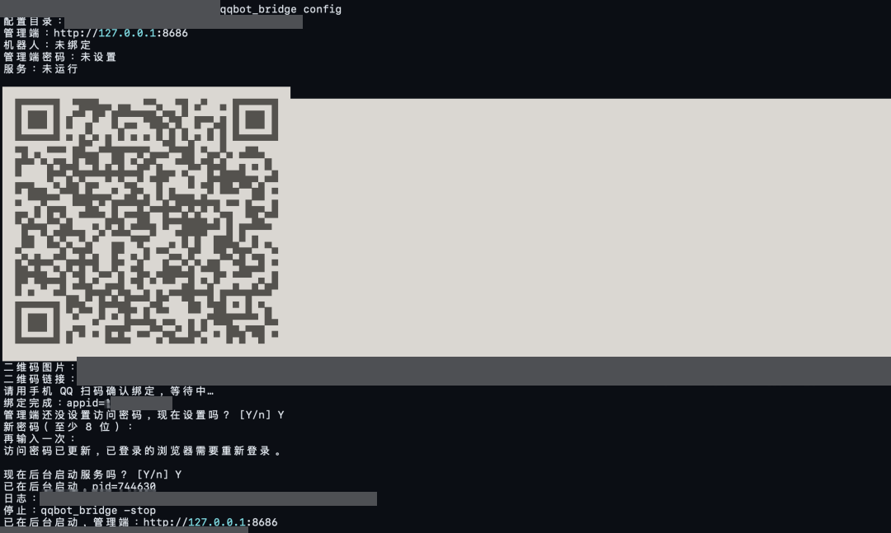
</p>

<p align="center"><sub><code>qqbot_bridge config</code> 跑起来就是这样：先打印当前状态，再出二维码等扫码，绑定完成后接着问要不要设管理端密码、要不要现在启动服务</sub></p>

脚本/无人值守用 `qqbot_bridge config -yes`：不交互，已绑定就跳过、不设密码。

二维码有效期有限，过期就重跑一次 `qqbot_bridge config`。旧的 `qqbot_bridge bind` 仍然可用，
行为不变（只扫码、不询问）。

## 第二步：启动

```bash
qqbot_bridge          # 后台运行（默认），关掉终端也不退出
qqbot_bridge -f       # 前台运行，日志直接打到终端
qqbot_bridge -stop    # 停止
```

用 systemd 托管（`install.sh --service` 已代劳，手动等价于）：

```bash
mkdir -p ~/.config/systemd/user
cp deploy/qqbot_bridge.service ~/.config/systemd/user/
systemctl --user daemon-reload
systemctl --user enable --now qqbot_bridge
```

> 程序默认会自己 `setsid` 后台化，交给 systemd 时必须带 `-f`，否则 systemd 会以为进程退出了。

Web 管理端在 <http://127.0.0.1:8686>，**需要密码登录**，先看下面两节。
启动后用 `qqbot_bridge -v` 或启动日志确认版本和构建时间。

## 命令一览

```text
qqbot_bridge                启动服务（默认后台运行）；-f 前台，-stop 停止，-addr 指定管理端地址
                            -home 换数据目录（多实例用，见「一台机器部署多套」）
qqbot_bridge config         服务初始化：扫码绑定、设管理端密码、提示启动（-force 强制重绑 / -yes 不交互）
qqbot_bridge bind           只做扫码绑定（config 的旧名字，-out/-source/-timeout 同 config）
qqbot_bridge passwd         设置 Web 管理端访问密码（交互输入，或从标准输入读取）
qqbot_bridge -v | version   显示版本号、构建时间和运行环境
qqbot_bridge -h | help      显示全部命令和参数
```

## Web 管理端

先设置访问密码（没设置前，管理端的所有页面和接口都拒绝访问）：

```bash
qqbot_bridge passwd                  # 交互输入两次，不回显
echo '新密码' | qqbot_bridge passwd  # 或从标准输入读取，适合脚本
```

密码至少 8 位，只存加盐哈希（`~/.qqbot_bridge/web-auth.json`，权限 0600）。改密码不用重启服务，
但所有已登录的浏览器都要重新登录。然后打开 <http://127.0.0.1:8686> 登录，页面有四个标签：

| 标签 | 内容 |
|------|------|
| 概览 | 网关状态、机器人昵称与 AppID、绑定信息、当前会话与任务、运行日志；未绑定时可在这里扫码 |
| 收到的消息 | 机器人收到的每条消息：时间、单聊/群聊、发送人（名字前带头像，取不到真实头像时显示首字母头像）、已受理/已拒绝/重复推送、内容，以及它**属于哪个对话**（收到那一刻的当前会话，点一下跳到该会话；被拒绝的消息不属于任何对话）。可按状态、按对话过滤和搜索；被拒绝的消息可一键加入白名单 |
| 白名单 | 查看、添加、移除白名单用户；列出最近被拒绝、还不在名单里的人 |
| 会话 | 每个会话的目录、模型、Git 状态、CodeBuddy 会话 ID，以及完整对话日志（用户/助手文本、推理、工具调用和结果，自动增量刷新，可向前翻页） |

页头会显示机器人的**昵称**和 AppID（如 `codebuddy-bridge · AppID 1906213188`），浏览器标签标题也带昵称。
昵称是网关登录成功后平台返回的，只放在内存里，所以服务刚重启、或者一直登录不上（比如 secret 错误）时不显示。

### 页面预览

**概览**：网关状态、机器人昵称与 AppID、绑定信息、当前会话与任务、运行日志。

<p align="center">
  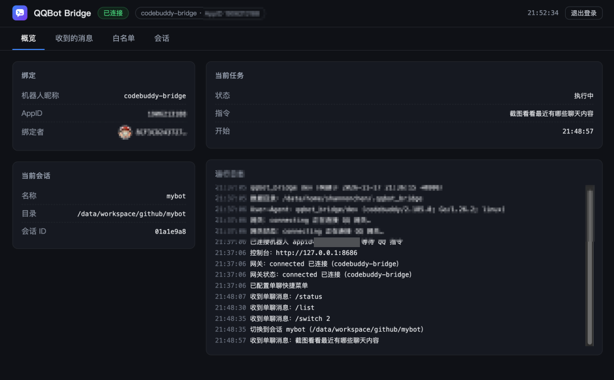
</p>

**收到的消息**：每条消息的时间、单聊/群聊、发送人、受理状态，以及它属于哪个对话；被拒绝的可一键加入白名单。

<p align="center">
  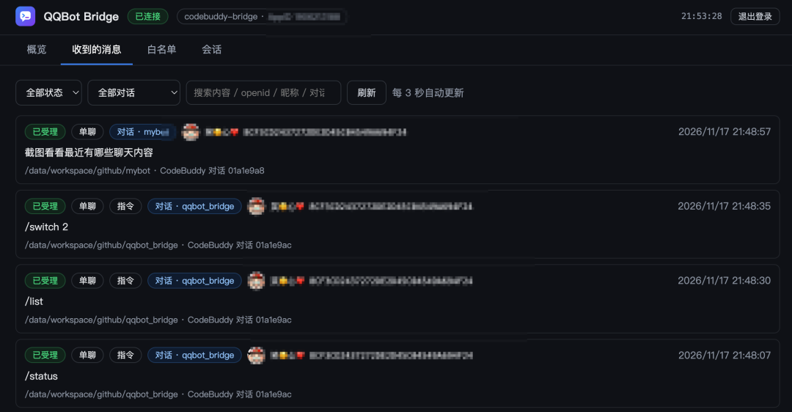
</p>

**白名单**：查看、添加、移除白名单用户，并列出最近被拒绝、还不在名单里的人。

<p align="center">
  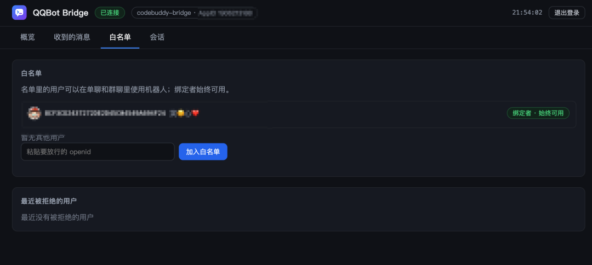
</p>

**会话**：每个会话的目录、模型、Git 状态、CodeBuddy 会话 ID，以及可增量刷新的完整对话日志。

<p align="center">
  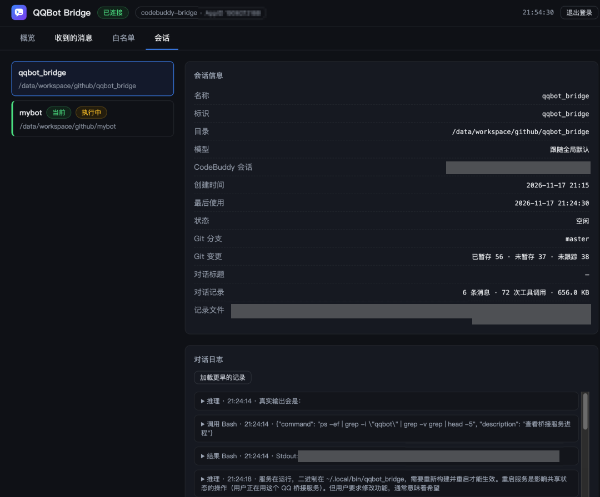
</p>

**Markdown 渲染**：消息内容和对话日志里的文字按 Markdown 显示——标题、粗体/斜体/删除线、行内代码、
代码块（带语言标签）、引用、有序/无序/任务列表（可嵌套）、表格（含对齐）、分隔线、链接。
单个换行显示为换行（聊天习惯）。工具调用和工具结果保持原样纯文本。不支持脚注、HTML 块、引用式链接，
这些会按普通文字显示。图片不会加载，显示成指向原地址的链接。

安全说明：

- 登录后下发 `HttpOnly` + `SameSite=Strict` 的会话 cookie，12 小时过期；同一来源连续输错 5 次会锁定 5 分钟。
- 页面带 CSP，不执行内联脚本。Markdown 渲染器全程用 DOM API 构造节点、不使用 `innerHTML`，
  消息里的 `<script>`、`onerror`、`javascript:` 链接只会显示成文字；链接只放行 `http` / `https` / `mailto`，并带 `noopener noreferrer`。
- 用户头像由服务端代理 `q.qlogo.cn` 并缓存 6 小时，页面本身不直连外部地址；取不到时显示首字母头像。
- 默认只监听 `127.0.0.1`。要从别的机器访问，把 `web.addr` 改成 `0.0.0.0:8686` 的同时，
  请放在 HTTPS 反向代理后面（服务本身不提供 TLS，密码会明文经过网络）。
- 收到的消息会按天存到 `~/.qqbot_bridge/messages/*.jsonl`（权限 0600，内容可能含隐私），保留 30 天，超期自动删除。

## 第三步：在 QQ 里用

给机器人发消息即可：

```
/list                     # 看有哪些会话（项目目录）
/new                      # 在当前目录再开一个会话
帮我看下这个项目的目录结构
```

随便发文字、语音、图片都行，语音会取平台转写结果，图片/文件落到当前项目下的 `.inbox/`
再把路径拼进指令。

## 指令

| 指令 | 说明 |
|------|------|
| `/list` | 列出所有会话，本次新发现的标 🔴 新增，每条带可点的切换标签 |
| `/1` `/2` … | 直接切到第 N 个会话 |
| `/switch <编号\|ID>` | 切换当前会话；不带参数等于 `/list` |
| `/new [目录] [名称]` | 新建会话并切过去；不带目录就在当前项目再开一个独立会话 |
| `/rename <名称>` | 重命名当前会话 |
| `/rm <编号\|ID>` | 移除会话记录，不删目录 |
| `/reset` | 清空当前会话的 CodeBuddy 上下文 |
| `/models` | 列出可选模型和倍率（按倍率从低到高），点标签切换 |
| `/model <ID\|名称>` | 只切换**当前会话**的模型；`/model default` 恢复全局默认 |
| `/driver [名字]` | 查看或切换**当前会话**用的 agent（`codebuddy` / `cursor`），切换会清空该会话上下文 |
| `/status` | 会话、目录、Git 状态、模型与倍率、任务进度 |
| `/stop [会话\|all]` | 中断当前/指定/全部任务 |
| `/sync` | 把当前会话同步到 CodeBuddy IDE 的「历史对话」 |
| `/menu` | 配置输入框下方的快捷菜单 |
| `/ping` | 检查机器人是否在线 |
| `/whoami` | 查看自己的 openid（加白名单要用） |
| `/allow <openid>` | 加入白名单，`/deny <openid>` 移出，`/allow list` 查看 |
| `/help` | 指令说明（每条都可点，点了填进输入框） |

指令标签用的是 QQ 的 `<qqbot-cmd-input>`，只填输入框、不替你发送；机器人没有
Markdown 权限时会自动退回纯文本，标签被剥掉，功能不受影响。

## 多人使用与白名单

默认只有扫码绑定的那个 QQ 号能用。要让别人也用：

1. 对方给机器人发任意消息，会收到「无权限使用这个机器人」；
2. 让对方发 `/whoami` 拿到自己的 openid（这条对陌生人放行）；
3. 你发 `/allow <openid>` 加进白名单，`/allow list` 能看到昵称。

- 绑定者始终可用，且不能被 `/deny` 移除。
- 白名单为空时只允许绑定者，升级后不会突然对所有人开放。
- 群聊按同一份名单判断：只有白名单成员 **@ 机器人** 的消息才会处理，其他人 @ 只回无权限提示。
- 也可以在 Web 管理端的「白名单」或「收到的消息」里直接点按钮放行，不用复制 openid。

## 模型与倍率

模型是 CodeBuddy 侧的概念，桥接只负责传 `--model`。

- `/models` 列出 CLI 当前支持的模型和倍率（`x0.11` 这种），按倍率从低到高排，★ 标当前会话在用的。
- 倍率来自 CodeBuddy 下发的模型目录，超过 10 分钟自动刷新（用 `echo` 模型刷新，实测不消耗额度）；刷新失败会标记为旧数据，不猜。
- `/model <ID>` 只改当前会话，下一条指令生效，正在跑的任务不受影响；`/model default` 回退到全局默认（`agent.model`）。
- 任务类回复末尾会带一行 `模型：xxx`；`/status` 里带模型、来源和倍率。
- 用 Cursor 时它不提供倍率：列表按 CLI 给出顺序展示，模型多的时候用 `/models <关键词>` 筛选，`/status` 不显示倍率。

## 配置

配置拆成两个 YAML 文件，都在 `~/.qqbot_bridge/` 下，权限 0600：

| 文件 | 内容 | 谁来改 |
|------|------|--------|
| `config.yaml` | 服务配置：机器人凭据与白名单、CodeBuddy 启动参数、回传策略、管理端地址 | 你手工编辑，或 `config`、管理端白名单页 |
| `sessions.yaml` | 会话配置：会话列表（目录、所用 agent、对话 ID）、当前会话、被你 `/rm` 掉的自动发现目录 | QQ 里的 `/new` `/switch` `/driver` `/rm` `/reset` 等，一般不用手改 |

这样拆是因为两者变化频率差很多：会话每发一条指令都会更新，而 `config.yaml` 里有 AppSecret，
不应该被这些日常变动反复改写。会话的变动只会写 `sessions.yaml`。

手工改 `config.yaml` 后重启生效（模型除外，下一条指令就生效）。键名写错时服务会拒绝启动并指出哪个键，
而不是悄悄忽略。没写的项沿用默认值。示例：

```yaml
bind:
  appId: "1906213188"
  secret: xxxxxxxx
  userOpenId: 8CF3CD2437272DE2D45C04549A694F24
  whitelist: [ABCD1234]
agent:
  driver: codebuddy      # 也可写 cursor，见「使用 Cursor」
  command: codebuddy
  timeoutMinutes: 300   # 默认 30，长任务可调大
push:
  maxMessages: 4
web:
  addr: 127.0.0.1:8686
```

| 字段 | 说明 |
|------|------|
| `bind.appId` / `bind.secret` | 扫码绑定后自动写入 |
| `bind.whitelist` | 允许使用的 openid 列表 |
| `agent.driver` | 用哪个 agent 驱动，默认 `codebuddy`；可选 `cursor`（需本机装好 `cursor-agent` 并登录，见「使用 Cursor」） |
| `agent.command` | 驱动的可执行文件，默认随 driver 变化（`codebuddy` / `cursor-agent`） |
| `agent.model` | 全局默认模型，留空跟随 CLI 默认；驱动不支持模型列表时 `/models` 会直接说明 |
| `agent.permissionMode` | 默认 `bypassPermissions` |
| `agent.timeoutMinutes` | 单轮任务超时，默认 30 分钟；跑长任务可以调大，如 300 |
| `push.maxMessages` | 被动回复条数预算，默认 4 |
| `push.showToolCalls` | 是否回传工具调用摘要 |
| `push.sendImages` | 是否回传本轮新生成的截图 |
| `push.markdown` | 是否优先用 Markdown 消息 |
| `web.addr` | 管理端监听地址，默认 `127.0.0.1:8686`；改成非本机地址时请加 HTTPS 反向代理 |
| `discover.disable` | 关掉自动注册 agent 正在使用的目录 |

**从旧版升级**：旧版把所有配置放在一个 `config.json` 里。新版第一次启动时发现只有 `config.json`、
没有 YAML，会自动拆分迁移，并把旧文件改名为 `config.json.migrated` 留作备份，启动日志里会说明。
迁移不会丢任何会话和凭据；确认没问题后可以自己删掉备份（里面有 AppSecret）。

另外，服务运行期间如果有别的进程（比如 `qqbot_bridge bind`）改了配置文件，服务下一次写配置前会先重新读取，
不会把刚绑定的新机器人覆盖回旧值。文件被手工改坏时，服务拒绝覆盖它并在日志里报错，等你修好。

## 回传策略

QQ 单聊同一条用户消息最多被动回复 4 次。一次任务的推送顺序是：收到确认 → 工具调用
摘要（可选）→ 结果 → 截图（最多 2 张）。被动额度用尽或被动回复失败（msg_id 过期、
限频）时自动改发主动消息，所以结果不会因为配额丢掉；主动消息也失败才放弃，并写日志。

长任务每 2 分钟推一次进度，同时保持「正在输入」状态。

## 团队协作

用户要求组队时，桥接会让 CodeBuddy 真的建团队（TeamCreate）；成员的每条消息会从会话
transcript 里跟读出来，以 `@角色名 · 摘要` 的独立消息推到手机上，leader 最后再给汇总。

这项能力和组队说明都只对 CodeBuddy 生效：Cursor 没有 TeamCreate，用 Cursor 时桥接不会让 agent 组队。

## 常见问题

**发了消息没反应**
看 `~/.qqbot_bridge/logs/日期.log`。常见三种：网关没连上、消息被去重丢弃（记「忽略重复推送的消息」）、白名单拦截（记「拒绝非白名单用户」）。

**回「无权限使用这个机器人」**
你的 openid 不在白名单里。发 `/whoami` 把 openid 给管理员。

**`/models` 报错或倍率是旧的**
桥接读的是 CodeBuddy CLI 的本地缓存（`~/.codebuddy/local_storage`），刷新要起一次 CLI。
先在机器人所在的用户下确认 `codebuddy -p --model echo "ping"` 能跑通；跑不通就是 CLI 登录或网络问题。

**服务起来了但日志里没有收到消息**
确认机器人绑定的是你的 QQ 号；群聊要 **@ 机器人** 才会收到。

**管理端打不开 / 提示「尚未设置访问密码」**
在服务器上运行 `qqbot_bridge passwd` 设置密码，刷新页面再登录。忘了密码也是重新运行它，不需要重启服务。
连续输错 5 次会锁定 5 分钟，等一会儿再试。

**启动时报「解析 config.yaml 失败」**
配置里有写错的键名或格式错误，错误信息会指出文件和键。修好后重启；在修好之前，服务不会覆盖这个文件。

**换机器**
把 `~/.qqbot_bridge/config.yaml` 和 `sessions.yaml` 拷过去即可（含 secret，注意安全；会话里的目录路径在新机器上要存在），或者在新机器上重新 `qqbot_bridge config`。

**升级**
重新拉代码后 `./scripts/install.sh`，再 `systemctl --user restart qqbot_bridge`（或 `qqbot_bridge -stop && qqbot_bridge`）。

## 卸载

```bash
systemctl --user disable --now qqbot_bridge 2>/dev/null
# 有模板实例的话逐个停掉，例如：
# systemctl --user disable --now qqbot_bridge@cursor
rm -f ~/.config/systemd/user/qqbot_bridge.service ~/.config/systemd/user/qqbot_bridge@.service ~/.local/bin/qqbot_bridge
rm -rf ~/.qqbot_bridge
# 其它实例的数据目录按需删除，例如 rm -rf ~/.qqbot_bridge-cursor
```

最后一行会删掉整个数据目录，里面有：

| 路径 | 内容 |
|------|------|
| `config.yaml` / `sessions.yaml` | 服务配置（含 AppSecret）/ 会话配置 |
| `config.json.migrated` | 从旧版迁移时留下的备份（含 AppSecret），确认没问题就可以删 |
| `web-auth.json` | 管理端密码哈希 |
| `messages/` | 收到的消息记录，按天一个文件，保留 30 天 |
| `logs/` | 运行日志，按天一个文件 |
| `qr-bind.png`、`qqbot_bridge.pid` | 最近一次绑定的二维码图片、后台进程的 pid |

只想重置管理端密码或清空消息记录，删对应的 `web-auth.json` 或 `messages/` 即可。
删了密码文件后管理端会拒绝所有访问，直到重新运行 `qqbot_bridge passwd`。

## 进阶

### 会话与并行

一个会话 = 一个工作目录 + 一段连续的 CodeBuddy 对话（`--resume`）。同一个会话同时只跑
一个任务，不同会话可以并行：A 在跑的时候切到 B 发指令会直接启动 B 的任务，`/status`
会列出其他正在跑的会话，`/stop` 默认只停当前会话。

`/list` 会自动扫 `~/.codebuddy/sessions/*.json`，把 CodeBuddy 正在用的目录注册成会话，
新目录标 🔴 新增；用 `/rm` 删掉的会记进 `discover.ignore`，不会反复冒出来。

### 语音与附件

- 语音：取平台转写的文字，等价于打字；没识别出文字会提示重发。
- 图片/文件：下载到当前目录的 `.inbox/`，最多 3 个、单个 20 MB，文件名会清洗并加时间前缀。

### 同步到 IDE 历史

任务进行中每 10 秒、结束时再一次，把对话镜像到 CodeBuddy IDE 的历史库（用户/助手文本、推理、工具调用）；
也可以随时发 `/sync`。IDE 默认不监听历史库，外部写入的内容要重启 IDE 才能看到。
想实时刷新，可以用 `scripts/patch_ide_history.py` 给 IDE 的 Genie 扩展打补丁（IDE 升级后要重打，
先 `--check` 查锚点能否匹配）。细节、排查和重打方法见 [docs/ide-history-patch.md](docs/ide-history-patch.md)。

不想改 IDE 的话，可以直接用 Web 管理端的「会话」标签看完整对话日志，不依赖 IDE。

### 使用 Cursor

把 `agent.driver` 切成 `cursor`，桥接改用本机的 Cursor CLI（`cursor-agent`）执行任务：

```yaml
agent:
  driver: cursor
  command: cursor-agent   # 可留空，默认就是它
```

准备：

- 安装：`curl https://cursor.com/install -fsS | bash`，确认 `cursor-agent --version` 能跑通。
- 登录：`cursor-agent login`，或给服务设置环境变量 `CURSOR_API_KEY`。systemd 托管时用 `Environment=` / `EnvironmentFile=`，
  见 `deploy/qqbot_bridge.service` 里的注释——桥接不读 Cursor 的 IDE 登录态，只认 CLI 自己的登录。
- 启动时桥接会用 `cursor-agent status --format json` 预检一次，未登录只在日志里告警，不阻止启动（Web 控制台还能用）。

和 CodeBuddy 的差异：

| 能力 | CodeBuddy | Cursor |
|------|-----------|--------|
| 执行任务、`/stop`、续聊 | ✅ | ✅（会话 ID 走 `--resume`） |
| `/models` `/model` | ✅ 带倍率 | ✅ 不带倍率（Cursor 不提供）；模型多时用 `/models <关键词>` 筛选 |
| Web 管理端看会话日志 | ✅ | ✅ |
| `/sync` 到 IDE 历史 | ✅ | ❌ 没有可写入的历史库，执行会说明「不需要同步」 |
| 自动发现已有会话目录 | ✅ | ❌ transcript 里没有工作目录，无法反推 |
| 团队协作（成员消息转发） | ✅ | ❌ TeamCreate 是 CodeBuddy 独有的 |
| 权限模式 | `bypassPermissions` 默认 | 默认加 `--force --approve-mcps`；`plan` → `--mode plan`；其他值不加强制参数 |

注意：

- 团队管理员禁用 Run Everything 时 `--force` 会被拒绝：把 `agent.permissionMode` 改成 `default`，再到 Cursor 的 allowlist 里放行需要的命令。
- 团队禁用 CLI 的 headless 模式时桥接无法驱动 Cursor，只能换回 CodeBuddy。
- 超过 100KB 的指令会写到工作目录的 `.inbox/` 下让 agent 自己读，避免超过单个命令行参数的长度上限。
- 手机端的输出约束只在每个新会话的第一轮注入（Cursor 没有追加系统提示词的参数），续聊不重复注入。

### 一台机器部署多套

想在一个用户下同时跑「一套 CodeBuddy、一套 Cursor」，就起多个实例：每个实例一个 QQ 机器人、
一个数据目录、一个管理端端口，进程之间完全独立。

**硬约束：一个 appid 只能给一个实例。** 同一个机器人开两条 WebSocket，平台会把事件分给其中一条，
表现是消息时有时无——这不是桥接能修的，必须各绑一个机器人。

数据目录优先级：`-home` 参数 > `$QQBOT_BRIDGE_HOME` > `~/.qqbot_bridge`。
配置、会话、pid、日志、消息记录、管理端密码库、绑定二维码都在这个目录下，换了目录就全部隔离。

两套的典型装法（假设机器人 A 给 CodeBuddy、机器人 B 给 Cursor）：

```bash
# 第一套：默认目录、默认端口
./scripts/install.sh --service                    # 装好 qqbot_bridge.service 并启动
qqbot_bridge config                               # 扫机器人 A

# 第二套：独立目录 + 独立端口 + 模板 unit
./scripts/install.sh --service --name cursor       # 装好 qqbot_bridge@cursor.service 并启动
qqbot_bridge -home ~/.qqbot_bridge-cursor config -addr 127.0.0.1:8687   # 扫机器人 B，配 Cursor
# 扫码完成后把 agent.driver 改成 cursor（config 生成的默认是 codebuddy）
systemctl --user restart qqbot_bridge@cursor
```

不用 systemd 时手动起也行：

```bash
qqbot_bridge -home ~/.qqbot_bridge-cursor -addr 127.0.0.1:8687          # 后台运行
qqbot_bridge -home ~/.qqbot_bridge-cursor -f                            # 前台看日志
qqbot_bridge -home ~/.qqbot_bridge-cursor -stop                         # 只停这一套
```

常用命令：

```bash
systemctl --user status qqbot_bridge            # 默认实例
systemctl --user status qqbot_bridge@cursor     # cursor 实例
journalctl --user -u qqbot_bridge@cursor -f     # 第二套的日志
```

要点：

- 每套的 `web.addr` 必须不同，否则第二个进程起不来（日志里会报端口被占用）。
- `-stop` 只停自己数据目录里的 pid，不会误停别的实例。
- 服务启动日志第一行会打印数据目录，多套时先看这一行确认自己连的是哪套。
- 用 Cursor 的那套需要本机已登录 `cursor-agent`，或者在自己的 unit 里配 `CURSOR_API_KEY`（见 `deploy/qqbot_bridge@.service` 的注释）。

### 同一个机器人里切换 agent

不想开两个机器人时，可以让一个实例里的不同会话分别用 CodeBuddy 和 Cursor：

```text
/driver              # 看当前会话用的 agent、全局默认和可选项
/driver cursor       # 当前会话切到 Cursor
/driver codebuddy    # 切回来
```

切换会**清空这个会话的对话上下文和模型设置**：CodeBuddy 的 sessionId 和 Cursor 的 chatId 互不通用，
模型 ID 也是两套。之后发一条新指令就会开新对话，其它会话不受影响。

切换后 `/models` `/model` `/status` `/sync` 都跟着会话走：`/models` 只列该会话 agent 的模型，
Cursor 会话没有 IDE 历史库，`/sync` 会直接说明不需要同步。
新建会话默认用全局 `agent.driver`；想让某个目录长期用 Cursor，也可以在 `sessions.yaml` 里给它加 `driver: cursor`。

User-Agent 是按进程发的（取全局 `agent.driver`），混用时它不随会话变化，这不影响功能。

### 开发

```bash
make test        # 全量测试（含一次真实 codebuddy 调用）
make test-short  # 跳过真实调用
make vet fmt
node --test internal/web/jstest/   # 单独跑前端 Markdown 渲染器的测试（go test 也会自动跑，没装 node 时跳过）
```

`make build` 会用 `git describe` 和当前 UTC 时间注入版本号与构建时间
（`-ldflags "-X main.version=… -X main.buildTime=…"`），没有 git 提交或 tag 时版本显示 `dev`。

目录：

| 路径 | 职责 |
|------|------|
| `main.go` | 只做两件事：转发构建时注入的版本信息、调用 `internal/cli` |
| `internal/cli` | 子命令（`config` / `bind` / `passwd` / `version`）、`-home` 多实例目录、后台化、启动预检与服务装配 |
| `internal/bridge` | 指令（`cmd.go`）、会话（`session.go`）、任务编排（`task.go`）、状态（`status.go`）、IDE 同步（`sync.go`）、模型（`models.go`）、目录发现（`discover.go`）、回复策略与白名单 |
| `internal/agent` | agent 驱动抽象：`Driver` / `Task` 接口、可选能力接口（模型目录、会话发现、transcript、IDE 历史库）与注册表 |
| `internal/agent/codebuddy` | CodeBuddy CLI 驱动（stream-json 协议）、版本探测、模型目录缓存、`genie/`（IDE 历史库镜像）、`discover/`（会话索引） |
| `internal/agent/cursor` | Cursor 驱动（`cursor-agent -p` 的 stream-json 协议）：参数映射、事件解析、模型列表、transcript 定位、登录预检 |
| `internal/gateway` | QQ OpenAPI 与 WebSocket 网关；所有请求统一带 `User-Agent: qqbot_bridge/<版本> (<驱动>/<版本>; Go/<版本>; <系统>)` |
| `internal/qrconnect` | 扫码绑定协议（与官方 `qqbot-connector` 一致） |
| `internal/termqr` | 终端 / SVG 二维码渲染 |
| `internal/config` | 配置：`config.yaml` + `sessions.yaml` 双文件、旧 JSON 迁移、`agent.driver` 归一化 |
| `internal/msglog` | 收到的消息记录（含所属对话） |
| `internal/web` | Web 管理端：登录、API、前端（`pages/` `static/`，编译时内嵌）、头像代理 |
| `scripts/` `docs/` `deploy/` | 安装脚本和 IDE 补丁脚本、文档、systemd 单元 |

想接新的 agent：在 `internal/agent/<名字>` 里实现 `Driver`，按需再实现 `ModelProvider` / `SessionDiscoverer` / `TranscriptProvider` / `HistoryMirror` / `Preflight`，
`init()` 里 `agent.Register`，最后在 `internal/cli` 里补一条 import（`drivers.go`）即可。`bridge` 会按能力接口自动降级（没有 `HistoryMirror` 就不做 IDE 同步，没有 `ModelProvider` 就说明不支持 `/models`），配置只需要多一个 `agent.driver` 的取值。
